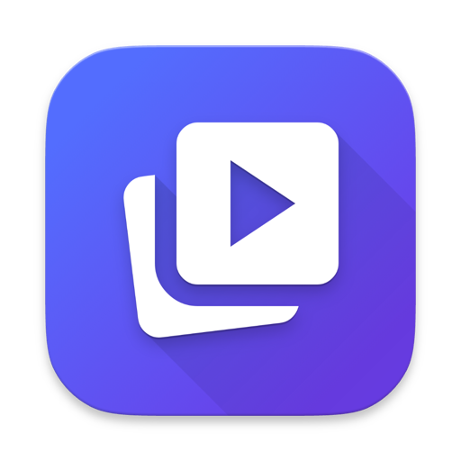

<p align="center">
  
</p>

<h1 align="center">VideoLibrary</h1>

<p align="center">
  A native macOS app for downloading, organizing and watching videos offline,<br>
  with a built-in music player. Designed for macOS 26+ and Liquid Glass.
</p>

<p align="center">
  <a href="https://github.com/Jotspot/VideoLibrary/releases/latest/download/VideoLibrary.zip"><b>Download for Mac</b></a> ·
  <a href="https://video.mistr.uk/">Website</a> ·
  <a href="https://github.com/Jotspot/VideoLibrary/releases">All releases</a>
</p>

<p align="center">
  <a href="https://github.com/Jotspot/VideoLibrary/actions/workflows/release.yml"></a>
  
  
  
</p>

---

VideoLibrary is a front end and library for [yt-dlp](https://github.com/yt-dlp/yt-dlp) built with Swift. Paste a link (or pick something from your own YouTube feed), and the video lands in a library you can browse, search, and watch in a clean, edge-to-edge player with great captions. Everything stays on your Mac or your own drives.

## Contents

- [Features](#features)
- [Install](#install)
- [Getting started](#getting-started)
- [Keyboard shortcuts](#keyboard-shortcuts)
- [Privacy and security](#privacy-and-security)
- [Building from source](#building-from-source)
- [Project layout](#project-layout)
- [FAQ](#faq)
- [Credits and license](#credits-and-license)

## Features

### Downloading
- **Any site yt-dlp supports**: YouTube, Nebula, Vimeo and over a thousand more.
- **Pick your quality**: Best Available, 4K, 1440p, 1080p, 720p or 480p, plus a size/quality balance.
- **Live progress** with the video's title shown as soon as it's known, and size estimates even for sites that don't report one.
- **Errors in plain language.** Instead of raw yt-dlp output you get what went wrong, why, and a one-click fix (sign in, update yt-dlp, try again…).
- **HD-first downloads.** YouTube sometimes only offers 360p to signed-in accounts, so downloads try without your sign-in first and only use it when a video needs it. Low-quality files already in your library are flagged with a **Re-download in HD** button that keeps your watch progress.
- **Resilient captions.** A rate-limited subtitle fetch doesn't fail the download; missing captions are fetched again later.

### Your library
- **Multiple libraries** in any folder, including external drives. Disconnected drives are shown as such and come back when you plug them in.
- **Import your own videos.** Add files you didn't download (recordings, clips, anything macOS can play). The file name becomes the title and an early frame becomes the thumbnail. Copy them into the library or leave them where they are.
- **Browse by uploader**, search, and sort by title, date added, upload date, length or size. Resolution badges (480p…4K), file sizes and watch progress on every card.
- **Total library size** at a glance, and moving videos between libraries.

### The player
- **Edge to edge.** The video fills the window; controls appear when you move the pointer and get out of the way when you don't. Full screen is one click (or opt in to always opening full screen).
- **Fit the window to the video** so there are no black bars, then snap back to your old window size when you leave.
- **Picture in Picture** and an in-app **miniplayer** that keeps an unfinished video going while you browse.
- **Frame-by-frame stepping**, 0.5×–2× speed, ±10 s skips, and **resume where you left off**.

### Captions
- **YouTube auto-captions done right.** Words appear as they're spoken, two lines at a time, without the box jumping around, instead of the usual stuttering "rolling" lines.
- **Fully styleable**: size, font, weight, color, one box / a box per line / outline / none, background opacity, top or bottom, with a live preview and one-click presets.
- **Calm by default**: caption animations are off, and captions stay up through short pauses so the box doesn't blink.

### Suggestions
- **Your real YouTube feed** (Subscriptions or Home) using your sign-in, with no Google Cloud project needed. The YouTube Data API is available as an advanced option and automatic fallback.
- **Search YouTube** right from the toolbar and download in one click.
- **Hide Shorts**, plus anything under a minimum length you choose.

### Sign-ins
- **Sign in inside the app**, or **import your sign-in from any browser**: Safari, Chrome, Arc, Dia, Brave, Edge, Firefox, Helium and more, including specific profiles.
- **Nebula** has its own section with browser import or an API token, kept separate from your YouTube sign-in.

### Watch anywhere at home
- **Share your library over Wi-Fi.** Scan a QR code and watch on your phone or another computer in the browser, with captions. Access is protected by a random token, and repeated wrong guesses are locked out.
- **AirDrop** any video in one click.

### Music (optional)
- Turn it on in **Settings › Music**, for one shared collection or per library (handy for music on an external drive).
- Add folders of MP3, M4A, FLAC, WAV and more. Tags and cover art are read automatically, and each folder becomes a playlist.
- Browse **Songs, Albums, Artists and Playlists**, plus **Liked Songs**, **Recently Played** and **Most Played**.
- **Play Next / Add to Queue**, a reorderable **Up Next**, shuffle, repeat, media keys and Control Center Now Playing.
- A **floating Liquid Glass player bar** that follows you around the app (hide it with a right-click, or automatically when you leave Music). Your queue is restored when you reopen the app.

### Built for the Mac
- Native SwiftUI on macOS 26, with **Liquid Glass** where Apple recommends it: toolbars, overlays, the player bar.
- A single **Settings** window for everything, including a **Tools** tab that shows your yt-dlp / ffmpeg / Deno versions and installs or updates them with Homebrew.

## Install

1. **[Download VideoLibrary.zip](https://github.com/Jotspot/VideoLibrary/releases/latest/download/VideoLibrary.zip)** and unzip it.
2. Move **VideoLibrary.app** to your Applications folder.
3. Open it. Because the app isn't notarized by Apple, macOS will block it the first time:
   open **System Settings › Privacy & Security**, scroll down, and click **Open Anyway**.
   <details><summary>Or use Terminal</summary>

   ```bash
   xattr -dr com.apple.quarantine /Applications/VideoLibrary.app
   ```
   </details>
4. Install the download tools with [Homebrew](https://brew.sh) (or click **Install** in **Settings › Tools**):

   ```bash
   brew install yt-dlp ffmpeg deno
   ```

**Requirements:** macOS 26 (Tahoe) or later, Apple silicon.

The tools are deliberately *not* bundled, so you can keep them current with `brew upgrade` (YouTube changes often, and an up-to-date yt-dlp fixes most download problems).

## Getting started

1. Click **+** in the toolbar and paste a video link, or open **Suggestions** to pick from your YouTube feed.
2. Watch progress in the downloads panel. The video appears in your library when it's done.
3. Click a video to play it. Move the pointer to show the controls; press **Esc** to go back.
4. Optional: in **Settings › Downloads**, sign in to YouTube (needed for age-restricted or members-only videos and for your feed).
5. Optional: add more libraries (for example on an external drive) in the sidebar or **Settings › General**.

## Keyboard shortcuts

| Key | Action |
| --- | --- |
| Space / K | Play / pause |
| ← / → | Back / forward 5 seconds |
| J / L | Back / forward 10 seconds |
| , / . | Previous / next frame |
| ↑ / ↓ | Volume up / down |
| M | Mute |
| C | Captions on / off |
| F | Full screen |
| I | Picture in Picture |
| Esc | Leave full screen, or back to the library |

In Music, **Space** plays and pauses while the song list is focused.

## Privacy and security

- **No accounts, no servers, no tracking.** VideoLibrary talks only to the sites you download from (and Google's APIs if you opt in to the Data API).
- **Sign-ins are encrypted at rest.** Cookies and tokens are stored with AES-GCM using a key kept in your macOS Keychain, never in plaintext files or preferences. yt-dlp gets a temporary decrypted cookie file in a private folder for each run, which is destroyed afterwards.
- **Older plaintext data is migrated** and removed automatically on launch.
- **Logs are redacted**: tokens, cookies and secrets are scrubbed before anything is written.
- **Local servers are locked down**: the sign-in callback listens on loopback only; Wi-Fi sharing requires a random 12-character token, compared in constant time, with lockout after repeated failures.

Because the app is ad-hoc signed, macOS asks once for Keychain access after installing or updating. Choose **Always Allow**.

## Building from source

You need the macOS 26 SDK (Xcode 26 or the matching Command Line Tools).

```bash
git clone https://github.com/Jotspot/VideoLibrary.git
cd VideoLibrary
brew install yt-dlp ffmpeg deno
./build.sh
open VideoLibrary.app
```

`build.sh` compiles with `swiftc` directly (plus `clang` for the vendored GCDWebServer) and assembles the `.app` bundle. It doesn't use `swift build`, because some Command Line Tools releases ship a `PackageDescription` library that fails to link SwiftPM manifests.

### Tests

The subtitle parser has a Swift Testing suite:

```bash
swiftc -target arm64-apple-macosx26.0 -sdk "$(xcrun --sdk macosx --show-sdk-path)" \
  -parse-as-library \
  Sources/VideoLibrary/Models/*.swift \
  Sources/VideoLibrary/Services/SubtitleParser.swift \
  Tests/VideoLibraryTests/SubtitleParserTests.swift \
  -framework Testing -o .build/SubtitleParserTests && ./.build/SubtitleParserTests
```

### Releases

Every push to `main` runs [`.github/workflows/release.yml`](.github/workflows/release.yml), which builds the app on a macOS 26 runner, ad-hoc signs it, and publishes `VideoLibrary.zip` to the release matching `CFBundleShortVersionString` in `Info.plist`. Pushing without changing the version refreshes that release's download; bump the version to cut a new release.

### Website

The site in `docs/` is hosted on Cloudflare Pages at [video.mistr.uk](https://video.mistr.uk). Publish changes with `./deploy-site.sh` (uses Wrangler; run `npx wrangler login` once).

## Project layout

```
Sources/VideoLibrary/
  VideoLibraryApp.swift     App entry point, windows, startup security check
  Models/                   VideoItem, DownloadTask, DownloadFailure, music models…
  Services/                 yt-dlp wrapper, library + music stores, players,
                            cookie/secret storage, browser import, sharing server
  Views/                    SwiftUI views: library grid, player, captions,
                            suggestions, music, settings
  Resources/AppIcon.icns
Vendor/GCDWebServer/        Embedded HTTP server for Wi-Fi sharing
Tests/                      Subtitle parser tests
docs/                       The project website (Cloudflare Pages, video.mistr.uk)
build.sh                    Builds VideoLibrary.app
```

Library data lives next to your videos in `{library}/.VideoLibrary/` (`library.json`, music, imported thumbnails). App settings live in `~/Library/Application Support/VideoLibrary/`, with encrypted secrets in its `secure/` folder.

## FAQ

**Downloads suddenly fail or only get 360p.** Update yt-dlp (**Settings › Tools › Update**, or `brew upgrade yt-dlp`). YouTube changes frequently. For 360p-only files, use **Re-download in HD**.

**macOS keeps asking for Keychain access.** That happens once per install or update because the app is ad-hoc signed. Choose **Always Allow**.

**Can it play MKV or WebM?** The player uses AVFoundation, so it plays what macOS plays (MP4, MOV, M4V…). Downloads are saved in a compatible format automatically; for imported files, convert others to MP4 first.

**Is this legal?** Download only content you have the right to, and follow each site's terms of service. VideoLibrary is a personal tool and isn't affiliated with YouTube, Google, Nebula or Apple.

## Credits and license

- [yt-dlp](https://github.com/yt-dlp/yt-dlp), [FFmpeg](https://ffmpeg.org) and [Deno](https://deno.com) do the heavy lifting for downloads (installed separately).
- [GCDWebServer](https://github.com/swisspol/GCDWebServer) by Pierre-Olivier Latour powers Wi-Fi sharing (BSD license, see `Vendor/GCDWebServer`).

VideoLibrary is released under the [MIT License](LICENSE).
